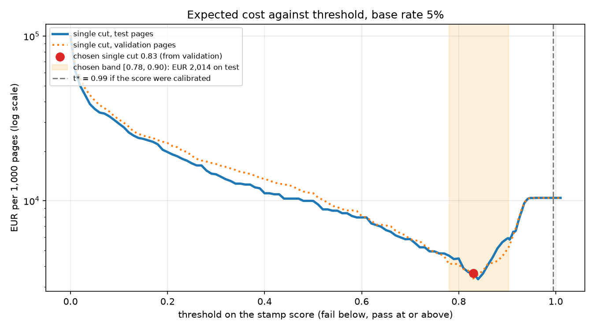

# Assignment 2 Report

- **Name**: Anna Serra
- **Student ID**: 18815
- **Email**: [aserrag.ieu2022@student.ie.edu](mailto:aserrag.ieu2022@student.ie.edu)
- **Group**: BBADBA 5B

## Business problem, and the cost of being wrong

For this assignment I wanted to keep working with the small M&A boutique from Assignment 1, but this time on the buy side, helping a client that wants to acquire a company. During the due diligence the target uploads its contracts to a data room, and before the client signs, an associate has to check that every important contract was actually executed, which in many of the countries these documents come from means that the page has to carry the company seal and not only a signature. This matters because a contract without the seal may not bind the company, so if a key lease or supply agreement turns out to be unenforceable after closing, the client has paid for something it doesn't really have. That is why my model looks at each execution page and gives it a stamp score, and two thresholds send the page to one of three outcomes: pass (treated as sealed), review (an associate checks it) or fail (flagged as unsealed, and the boutique asks the seller for an executed copy).

I treat an unsealed page as the positive class, because it is the case that needs an action, the same way the defective bottle was the positive class in Session 11. So a false negative is an unsealed page that the model passes, and a false positive is a sealed page that the model flags, and the truth is that these two mistakes cost very different amounts. A false negative puts an unenforceable contract into a closed deal, which most of the time changes nothing, but sometimes ends up turning into a price adjustment or an indemnity fight, so I price it at €2,000 per page (a 2% chance that it becomes a real problem times €100,000, which is the same magnitude as the €150,000 fee from Assignment 1). A false positive only costs about ten minutes of an associate raising the page with the seller, which at €62.50 an hour (the €3,000 day of the six associate team from Assignment 1, over eight hours) is about €10.42. That is why a missed seal is around 192 times worse than a false alarm, so the thresholds have to buy recall on unsealed pages even if that means a lot of false alarms, and it is also why I don't use accuracy or F1, since both treat the two mistakes as if they cost the same.

## Dataset

I used [stamp-signature-qr](https://universe.roboflow.com/hrsdyolo/stamp-signature-qr/dataset/1) from Roboflow Universe, **workspace `hrsdyolo`, project `stamp-signature-qr`, version 1** (MIT licence), downloaded as it is in YOLOv11 format. It has 9,777 images resized to 640x640 and four classes, `Signature`, `Text`, `qr-code` and `stamp`, where one image is one page or photo and each box marks one object on it.

At first I had in mind a signing day check, confirming that every page is both signed and stamped, but looking at the images changed my mind. The four classes actually come from separate collections that were merged together: the stamp images are real executed documents, the signature images are old business letters from the 1970s to the 1990s, mostly inverted (white text on black), and the qr-code images are mostly photos of QR codes on desks and phones. This means stamps, QR codes and signatures never appear on the same page, so the stamp pages have signatures that nobody labelled, and a model trained on this ends up learning that "inverted letter means signature" instead of what a signature looks like. That is why I narrowed the decision to the seal, which is the only class with enough examples on pages that look like a real data room (property contracts, notarised agreements, court papers). The other three classes stay in the model and I report them, but no decision depends on them.

## What the dataset's composition implies

The split is 7,657 train, 1,343 validation and 777 test images (78/14/8), and the classes are very unbalanced:

| Class | Train instances | Val instances | Test instances | Test images with the class |
| --- | ---: | ---: | ---: | ---: |
| stamp | 8,254 | 2,408 | 1,220 | 581 |
| qr-code | 4,411 | 212 | 184 | 156 |
| Text | 271 | 97 | 43 | 13 |
| Signature | 168 | 31 | 41 | 40 |

The first thing this tells me is that only the stamp numbers can be trusted. With 41 signatures and 43 text boxes in test, one detection more or less moves their recall by more than two points, so I wouldn't draw conclusions from those classes, while the stamp class has 1,220 test instances, which is enough for its numbers to mean something. Seals are also small but very consistent in size, so I would expect the model to find most of them and to struggle more with tight boxes (mAP50-95) than with finding them (mAP50).

The second implication matters more for the decision. Every image has at least one label, so there are no blank pages, and the only pages without a stamp are 40 inverted letters in test, which don't look like an unsealed contract. If I measured the model only on those, it would look almost perfect for reasons that have nothing to do with seals. That's why I built a stress test in `train.py`, so I took every sealed test page and painted over the labelled seals with the paper colour, which gives an unsealed version of the same contract. The weakness is that the labels often miss a second seal, which then stays on the page, so the stress test is harsher than reality and the letters are softer, and the true cost of the model is in between. Also, since the test split comes from the same collections as training, a good test number only says the model reproduces these labels on these pages, not that it will work on a real data room with different seals, scanners and languages.

### Data leakage between the splits

I compared every test page with the training images pixel by pixel (since Roboflow renames the files) and found that only 17 sealed test pages and 25 validation pages are exact duplicates, which is the real leakage. Many other stamp pages share the same underlying letter with a training image, because the author pasted different stamps onto the same documents, but that isn't leakage of what the model has to find, since the stamp itself is different, although seeing the same background can make false alarms look a bit rarer on those pages. That is why I also checked the model only on the 174 sealed test pages with no copy in training, and it did just as well (stamp AP50 of 0.991), while choosing the thresholds again on clean validation pages gave the same band at €2,313 per 1,000 pages instead of €2,014.

## Finetuning and baselines

I chose object detection because the decision is about if a specific object is somewhere on the page, and a detector also shows the associate where the seal is, so they will review it faster. I finetuned `yolo11s` from its COCO checkpoint instead of `yolo11n`, because a seal is only about 3% of the page and the extra capacity helps with small objects, and speed doesn't matter that much since pages are checked one at a time. I trained it on my laptop for 30 epochs at 640x640, batch 16, `patience=10`, `seed=0` and `deterministic=False` (like in Session 9), which took 3 hours and a half. The best checkpoint was the last epoch will a validation of mAP50 = 0.820.
For the baselines they use the same test split. The COCO model has no stamp class, so it can only use its closest word, and on validation that was `clock`, so I gave it the best chance by treating `clock` as "stamp", and the trivial baseline predicts nothing, which is the same as passing every page.

| Model (test split, stamp class) | AP50 | Recall at conf 0.25 | Cost per 1,000 pages at its best cut |
| --- | ---: | ---: | ---: |
| Finetuned yolo11s | **0.982** | 0.975 | **€3,622** |
| COCO zero-shot (`clock` as stamp) | 0.155 | 0.037 | €9,718 |
| Predict nothing | 0.000 | 0.000 | €100,000 |

The finetuned model beats both baselines by a lot, which I expected, because a class that isn't in the vocabulary can't be fixed with a threshold. The COCO model only finds 3.7% of the seals, so to catch the unsealed pages it ends up flagging almost every page. Overall, the finetuned model gets a test mAP50 of 0.824 and a mAP50-95 of 0.614, but that average is pulled down by the classes the decision doesn't use.

## Per-class evaluation and failure modes

For every decision number in this report the positive class is the **unsealed page**, but the table below is the detector's own view, where each class is the positive one.

| Class | Test instances | Precision | Recall | AP50 | AP50-95 |
| --- | ---: | ---: | ---: | ---: | ---: |
| stamp | 1,220 | 0.955 | 0.975 | **0.985** | 0.811 |
| qr-code | 184 | 0.977 | 0.984 | 0.984 | 0.925 |
| Signature | 41 | 0.770 | 0.951 | 0.921 | 0.492 |
| Text | 43 | 0.399 | 0.479 | 0.405 | 0.226 |

The stamp class carries the headline number, and it is the only one that is both high and backed by enough examples. Its AP50-95 is lower than its AP50, which means that the model finds the seal but draws the box a bit loose, and that doesn't matter here because I only need to know if a seal is there. Text drags the average down, and Signature looks good, but I don't trust it, because it has only 41 instances, all on inverted letters, so the model can score well just by recognising that type of page. In the confusion matrix the classes are never mixed up with each other, all the errors are with the background, like for stamps, 1,192 of the 1,220 seals are found, 28 are missed and 67 boxes are where nothing was labelled.

| Predicted ↓ / True → | Signature | Text | qr-code | stamp | background (box on nothing) |
| --- | ---: | ---: | ---: | ---: | ---: |
| Signature | 39 | 0 | 0 | 0 | 14 |
| Text | 0 | 25 | 0 | 0 | 43 |
| qr-code | 0 | 0 | 181 | 0 | 4 |
| stamp | 0 | 0 | 0 | **1,192** | 67 |
| background (missed object) | 2 | 18 | 3 | 28 | – |

To see what actually breaks, I looked at the failures one by one. Many of the 67 "false positive" stamps are real seals that nobody labelled, so the label noise makes the model look worse than it is. The seals it really misses are faint blue stamps, rectangular stamps printed over text, and seals cut off at the edge of the scan. But the most important failure showed up in the stress test, of the 59 pages that still scored 0.5 or more after I painted out the seal, 32 still had a real seal the labels missed (so there the model is right), and 15 of the other 27 were letterhead logos and crests. That matters for the business, because a crest looks like a seal to the model, so an unsealed contract on a headed paper is exactly the page it is most likely to pass by mistake.

## Cost matrix and operating point

The costs come from the business problem I exlained, and they are my assumptions, which is why I also show which ones change the answer.

| Outcome (positive = unsealed page) | Cost per page | Where it comes from |
| --- | ---: | --- |
| FN: unsealed page passed | €2,000 | 2% chance of a real problem × €100,000 |
| TP and FP: page flagged | €10.42 | 10 minutes of an associate at €62.50/hour |
| TN: sealed page passed | €0 | nothing happens |
| One associate review | €0.52 | 30 seconds at €62.50/hour |
| Associate as a second classifier | recall 95%, specificity 99% | people miss things too (Session 11) |

I assume a base rate of 5%, meaning one execution page in twenty has no seal, because data rooms are full of scanned copies and drafts uploaded by mistake, but I don't have a source for it, so I also vary it below. The test split is nothing like that mix (about half of the pages are unsealed once the stress pages are in), so like in Session 11 I measure how sealed and unsealed pages fall into each zone separately and then mix them at 5% to get a cost per 1,000 pages.

I swept the threshold on the stamp score, chose the cheapest one on validation and reported it on test, so the number I quote wasn't used to choose itself (the same I did for C in Assignment 1 basically). The cheapest single cut is 0.83, at €3,622 per 1,000 pages on test, and the curve below shows that it is in a narrow valley, so lower cuts pass more unsealed pages, which is the expensive error, and higher cuts start flagging most of the sealed pages.

Session 12 gives another way to get the threshold, if the score were a real probability, the cut would be t* = 1 − 10.42/2,000 = 0.995. Here that would be a disaster, because the score isn't calibrated (no page scores above 0.956), so a cut at 0.995 flags every single page and costs €10,417 per 1,000. That is why I chose the threshold by sweeping instead of with the formula.

The assumption that changes my answer the most is the cost of a missed seal, followed by the base rate:

| Assumption changed (band re-chosen on validation) | Fail below | Pass at or above | Sent to an associate | Cost per 1,000 pages |
| --- | ---: | ---: | ---: | ---: |
| As assumed | 0.78 | 0.9025 | 41.7% | €2,014 |
| Missed seal costs €500 | 0.51 | 0.9025 | 42.9% | €1,141 |
| Missed seal costs €10,000 | 0.78 | 0.9425 | 92.8% | €2,225 |
| Base rate 1% | 0.51 | 0.89 | 36.4% | €713 |
| Base rate 20% | 0.78 | 0.9425 | 78.7% | €3,476 |
| Only the 40 real letters, no stress test | 0.02 | 0.02 | 0% | €5,512 |

In every case I tried the band is still the cheapest design, but how much goes to review changes a lot. If a missed seal were worth less than about €250, the associate would only need to see around 7% of the pages, and if it were worth more than about €5,000, almost every page would go to review, because at €0.52 a review it's cheaper to have a person look than to risk a miss. So my answer depends a lot on how risky a contract really is for this client, and that is a conversation for the deal team, not something the model can tell me. The last row also shows why I needed the stress test, because choosing the threshold only on the easy letters gives a cut of 0.02, which ends up costing more than double.

## What a person still has to check

My two thresholds are **fail below 0.78** and **pass at or above 0.9025**,which were the cheapest on validation. Almost all unsealed pages fall below 0.78 and get flagged automatically, while about half the sealed pages pass directly and the rest go to review, so at a 5% base rate the band sends **41.7% of pages to an associate**.

With two due diligences of about 3,000 execution pages each over ten days, the boutique sees around 600 pages a day. The band sends 250 of them to review (30 seconds each, so 2.1 hours) and flags 39 (ten minutes each, so 6.5 hours), so it needs 8.6 hours a day, and about 1.4 associates. I think that is realistic, since out of a team of six it means one associate on this for the length of the due diligence plus half the day of another one, and most of the time goes to the flagged pages, not the review queue. The thing the cost table doesn't show is that the review queue is almost entirely sealed pages, which is exactly when people stop paying attention, so following Session 11 I wouldn't show the associate the model's score before they decide, and I would mix in a few known unsealed pages to actually measure their 95% recall.

| Design (projected to a 5% base rate) | Cost per 1,000 pages | Missed seals per 1,000 | Sent to an associate | Associates needed |
| --- | ---: | ---: | ---: | ---: |
| Do nothing (pass every page) | €100,000 | 50.0 | 0% | 0 |
| An associate checks every page | €6,115 | 2.5 | 100% | 1.8 |
| Model alone, single cut 0.83 | €3,622 | 1.2 | 0% | 1.9 |
| **Three way band [0.78, 0.9025)** | **€2,014** | **0.6** | **41.7%** | **1.4** |

The band is the cheapest option, and a bootstrap of the test pages (as in Session 3) puts its cost between €1,294 and €2,797 per 1,000 pages, still below an associate checking everything. Doing nothing is by far the worst, because 50 missed seals at €2,000 each is €100,000. Having an associate check everything is not only more expensive but also misses more seals, because the associate's 95% recall is worse than the model's on the easy pages, which is the same lesson as the technician in Session 11. What surprised me is that the model on its own needs more associate time than the band, because without a review step it has to flag many more sealed pages, and each flag costs ten minutes while a review only costs 30 seconds.

## Limitations & next steps

The biggest limitation is the labels. The stamp labels often miss some of the seals on a page, which makes the model's precision look worse than it is and contaminates my stress test, so with more time I would relabel every seal on the test pages. On top of that, the dataset is a merge of separate collections, so the only real unsealed pages are 40 old letters, and the right fix is to collect a few hundred real execution pages from past data rooms (with permission and handling the personal data under GDPR) and choose the band on those.

The failure that worries me the most is logos and crests being read as seals, because it causes the expensive error on a very common type of page. I would fix it by adding headed paper without seals to the training data, and maybe by ignoring stamp boxes at the very top of the page, checking that real seals near the top are still found. The stamp score also isn't calibrated, which is fine for choosing thresholds by sweeping, but if the boutique wanted to read it as a probability I would add a calibration step (Platt or isotonic, as in Session 12). And since validation mAP was still going up at epoch 30, a longer run might help a bit, although most remaining stamp errors are about labels rather than the model.

Finally, every euro figure is an assumption, especially the €2,000 for a missed seal, the 5% base rate and the associate's 95% recall. Before using this for real I would ask the deal team what an unenforceable contract really costs, count the unsealed pages in a few past data rooms, and test the associates with known unsealed pages. That is why the dashboard keeps the base rate as a slider, so the band can be priced again once those numbers are real.

## Generative AI use disclosure

I used Claude Code to help assess the leakage and to write `train.py`, `costing.py` and `app.py` following the structure of the notebooks from Sessions 9, 11 and 12, with my decisions on the framing, the positive class and the cost assumptions. It also helped with the grammar and the format of this report (tables, links, the image of the cost curve, highlighting and putting the technical names between backticks).
